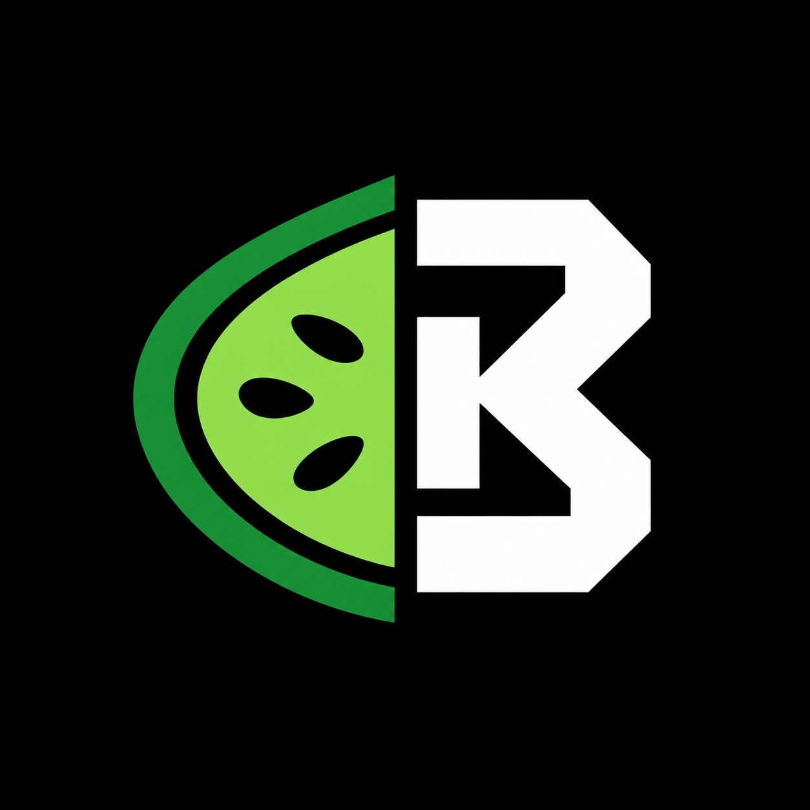

<h1 align="center">BepInEx + MelonLoader Bridge (Next-Gen) </h1>

  <b>Universal All-in-One Modding Bridge for Unity Mono & IL2CPP by GEclipseKnight</b> 
  Run <b>BepInEx 5 / 6</b> plugins and modern <b>MelonLoader 0.7.x+</b> mods simultaneously in any 64-bit Unity game (Unity 2018 – Unity 6+)!

  

 

## 🔥 Key Features / Главные особенности
* **Full Unity Mono & IL2CPP Support:** Includes dedicated builds for both **Unity Mono** (`BepInEx 5.4.23.6` + `Mono.dll`) and **Unity IL2CPP** (`BepInEx 6.0.0-be.788` + custom lightweight `Il2Cpp.dll` support module).
* **Modern MelonLoader 0.7.3+ Core:** Rebuilt internal core with `Tomlet 6.2.0.0` serializer — fixes `MissingMethodException` and loads modern `0.7.x` mods out of the box.
* **Wide Unity Engine Support:** Tested and verified across multiple Unity generations — from **Unity 2018–2020** (*Subnautica*, *Papers, Please*) up to **Unity 6 / 6000.x** (*R.E.P.O.*, *Content Warning*, *Vampire Survivors*).
* **Zero Conflicts:** Uses `winhttp.dll` as the primary entry point with unified console output, shared `HarmonyX` patching, and pre-installed **Configuration Manager 19.1** (`F1` on Mono builds).
* **Portable & Ready-to-Use:** Pre-configured folder structure (`BepInEx` + `MLLoader` + `Dependencies\SupportModules`). Just extract and play!

---

## 📦 Installation / Установка

1. Download the archive matching your game's Unity backend from the **[Releases](../../releases)** page:
   * **Unity Mono (`MonoBleedingEdge` folder):** **`BepInEx-MelonLoader-0.7.3-Bridge-v3.0.0-UnityMono-x64.zip`**
   * **Unity IL2CPP (`GameAssembly.dll` file):** **`BepInEx-MelonLoader-0.7.3-Bridge-v3.0.0-UnityIL2CPP-x64.zip`**
2. Extract all files into your game's root folder (where the game's `.exe` is located).
3. Place your mods in the corresponding folders:
   * **BepInEx 5 / 6 mods (`.dll`):** `GameFolder\BepInEx\plugins\`
   * **MelonLoader 0.7.x mods (`.dll`):** `GameFolder\MLLoader\Mods\`
   * **MelonLoader 0.7.x plugins (`.dll`):** `GameFolder\MLLoader\Plugins\`
   * **MelonLoader libraries (`.dll`):** `GameFolder\MLLoader\UserLibs\`
4. Launch the game! *(On Mono builds, press **`F1`** to open the in-game BepInEx Configuration Manager).*

---

## 🛠️ Tested Games / Проверенные игры

### Unity Mono
* **R.E.P.O.** (Unity 6000.3.17f1 Mono)
* **Content Warning** (Unity 6000.0.67f1 Mono)
* **Subnautica** (Unity 2019.4.36f1 Mono)
* **Initial Drift Online** (Unity 2019.4.41f2 Mono)

### Unity IL2CPP
* **Vampire Survivors** (Unity 6000.0.62f1 IL2CPP)
* **Among Us** (Unity 2022.3.44f1 IL2CPP)
* **Papers, Please** (Unity 2020.3.34f1 IL2CPP)
* *And any other 64-bit Unity Mono or IL2CPP game!*

---

## 📜 Credits & License
* Updated, rebuilt for MelonLoader 0.7.3 & Tomlet 6.2.0.0, custom `Il2Cpp.dll` written and maintained by **GEclipseKnight**.
* Based on the open-source architecture of [BepInEx](https://github.com/BepInEx/BepInEx), [MelonLoader](https://github.com/LavaGang/MelonLoader), [Tomlet](https://github.com/SamboyCoding/Tomlet) and [BepInEx.MelonLoader.Loader](https://github.com/BepInEx/BepInEx.MelonLoader.Loader).
* Licensed under **LGPL-2.1**.
